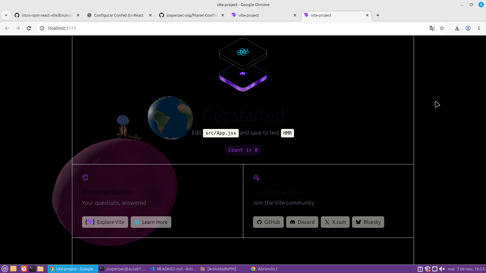

# Actividad NPM – React, componentes y Git

## Descripción

En esta actividad he trabajado con NPM, React, Vite y Git, creando diferentes componentes y organizando el desarrollo mediante ramas independientes.

El objetivo ha sido probar distintas dependencias, incorporar una escena 3D y aprender a gestionar los cambios mediante merges.

## 1. React Confetti

He instalado la dependencia `react-confetti` y he añadido un componente de confeti a la aplicación.

## 2. Canvas Confetti

He instalado `canvas-confetti` y he creado un botón que permite lanzar partículas de confeti al pulsarlo.

## 3. Escena 3D con Three.js

He incorporado una escena 3D utilizando Three.js y he separado su código en el componente `PlanetScene.jsx`. El modelo y sus animaciones se encuentran en la carpeta `public`.

## 4. Gestión de dependencias y Git

He creado tres ramas para trabajar de forma independiente:

- `react-confetti`
- `canvas-confetti`
- `three`

Posteriormente, he seleccionado el componente de confeti que quería conservar, lo he fusionado con `main` y he eliminado la dependencia descartada. Finalmente, he incorporado la escena 3D a la rama principal.

## 5. Pregunta: Si la carpeta node_modules/ está excluida, ¿borrar una dependencia hace alguna acción sobre el repositorio? ¿Cuál?

Sí. Aunque la carpeta `node_modules/` está excluida del repositorio mediante `.gitignore`, al desinstalar una dependencia con `npm uninstall` se modifican los archivos `package.json` y `package-lock.json`.

Estos archivos sí están incluidos en Git, por lo que sus modificaciones aparecen en `git status` y se pueden guardar mediante un commit.

Por tanto, no se suben los archivos de la dependencia que estaban dentro de `node_modules/`, pero sí se registra en el repositorio que esa dependencia ha sido eliminada del proyecto.

## 6. Despliegue

Enlace a la página web desplegada:

**Pendiente de completar en el punto 10.**
